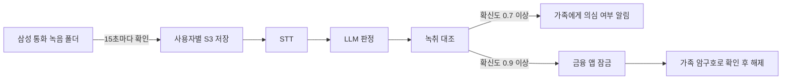

# CodySafe

> 통화 후 2차 피해를 가족과 함께 막는 AI 사기 대응 서비스
>
> 코디세이 AI 해커톤 2026 · 팀 유레카 · 주제 02 「AI 기반 정보보호 서비스」

보이스피싱은 전화가 끝난 뒤에도 이체와 앱 설치로 이어집니다. CodySafe는 통화 녹음을 분석해 본인에게 근거를 보여 주고, 가족에게 의심 여부만 알리고, 금융 앱을 잠가 추가 피해를 줄입니다.

- **대상:** 보이스피싱에 노출된 사용자와 그 가족
- **범위:** 일반 앱은 통화 음성을 실시간으로 받을 수 없어 통화 후 분석합니다. 이유는 [기획서](docs/family-guard-plan.md#2-왜-실시간-통화-분석을-하지-않는가)에 있습니다.
- **상태:** 동작하는 프로토타입입니다. [구현 상태](#구현-상태)를 함께 봐 주세요.

## 동작 흐름



## 주요 기능

| 기능 | 내용 |
|---|---|
| 통화 검사 | 새 녹음을 자동으로 STT 변환해 판정합니다. 웹은 파일 업로드 방식입니다. |
| 근거 표시 | 판정 근거 문장을 녹취와 대조해, 통화에 실제로 있는 말만 보여 줍니다. |
| 가족 알림 | 초대 코드로 연결하며, 가족에게는 의심 여부와 잠금 상태만 전달합니다. |
| 금융 앱 잠금 | 강한 의심 시 은행, 카드, 간편결제, 증권, 원격제어 앱 47개를 막고 경고합니다. |
| 가족 암구호 | 연결된 가족이 매일 바뀌는 단어로 본인을 확인합니다. |
| 사기 체험 | 12개 수법을 5턴 대화로 연습합니다. |
| 커뮤니티 | 수법을 제보하고 추천합니다. 상위 3개는 AI 체험 시나리오로 만들 수 있습니다. |
| 피드백 | 사용자가 판정을 확인하면 AI 판정과 사람 판정을 데이터셋에 쌓습니다. |
| 대시보드 | 사용자는 자기 체험 점수와 약한 수법을, 관리자는 개인을 알 수 없는 집계와 오탐률을 봅니다. |

## 구현 상태

| 부분 | 상태 |
|---|---|
| 녹음 업로드, STT, LLM 판정 | 구현, 실제 음성 파일로 확인 |
| 근거 대조, 가족 알림, 암구호, 커뮤니티 | 구현, 자동 테스트와 브라우저 시연으로 확인 |
| 사용자별 S3 저장 | 구현, 실제 버킷에 시험 파일로 확인 |
| 15초 폴더 감시, 금융 앱 차단 (Android) | 구현, 실기기 동작 미확인 |
| 사례 검색 (RAG) | 외부 검색 서버를 `GUARD_RAG_URL`로 연결하면 판정 전에 참고 자료로 넣음. 내장 검색은 판정 뒤 유형 표시에 쓰며 벡터는 해시 임베딩. 효과 미측정 |
| 피드백, 사용자·관리자 대시보드 | 구현, 자동 테스트와 브라우저로 확인 |
| 재학습, 검색 색인 갱신 | 추후 과제 |
| L4 GPU 자체 STT | 미구현 |
| 탐지율, 오탐률 | 미측정. 예시 대본 6건은 동작 확인용이며 성능 근거가 아님 |

## 실행

```bash
git clone https://github.com/rla8127/CodySafe.git
cd CodySafe/server
python3 -m venv .venv && .venv/bin/pip install -r requirements.txt
.venv/bin/python -m pytest -q
```

키 없이 규칙 판정으로 실행합니다. `.txt` 파일을 녹취로 간주하는 테스트 모드입니다.

```bash
.venv/bin/uvicorn guard.app:app --port 8091
# http://localhost:8091/app/
```

실제 분석에는 `server/.env`가 필요합니다. 이 파일은 커밋되지 않습니다.

```
ANTHROPIC_API_KEY=
OPENAI_API_KEY=
GUARD_LLM=anthropic
GUARD_STT=openai
```

S3 설정과 전체 옵션, APK 빌드는 [실행 문서](docs/family-guard.md)에 있습니다.

- **PC 웹:** 왼쪽 메뉴와 접을 수 있는 모바일 미리보기로 표시합니다.
- **시연 가족:** 웹에서 등록된 가족 5명 중 한 명으로 들어갑니다. 누구나 같은 기록을 보므로 실제 통화를 올리지 않습니다. `GUARD_DEMO_FAMILY=0`이면 꺼집니다.

## 구조

```
server/guard/    API, 판정 파이프라인, RAG, 제보, 암구호
server/web/      웹 화면
server/tests/    자동 테스트
android/         WebView 앱, 폴더 감시, 금융 앱 차단
index.html, css/, js/, assets/   공용 화면 자원과 초기 웹 MVP
docs/family-guard-plan.md        기획서
docs/project-plan.md             초기 QR 판독 기획 (이번 제출 범위 아님)
```

## 데이터와 개인정보

- 통화 상대의 음성도 전송되므로 동의한 통화나 테스트 파일로만 사용합니다.
- 음성은 STT를 위해 OpenAI로, 글자 기록은 판정을 위해 Anthropic으로 전송됩니다.
- 시연 버킷은 미국 리전에 있습니다. 실제 서비스에는 국내 리전이나 국외 이전 고지, 서버 HTTPS가 필요합니다.
- 분석 내용은 본인만 조회합니다. 일상 통화의 글자 기록은 저장하지 않습니다.

## 팀

박병국, 김동현, 정호연, 유상우, 전선형

## 외부 자원

| 이름 | 용도 |
|---|---|
| Anthropic Claude (`claude-opus-5-5`) | 사기 판정, 재순위, 시나리오 생성 |
| OpenAI `whisper-1` | 음성 변환 |
| Amazon S3 | 음성 저장 |
| FastAPI, SQLite | 서버 |
| AndroidX WorkManager, DocumentFile | 앱 |
| SUIT 2.0.5, Lucide 0.460.0 | 폰트, 아이콘 |

**사전 보유 코드:** 웹 화면 코드(`index.html`, `css/`, `js/`, `assets/`)는 주제 공개(2026-10-30 11:00) 전인 2026-10-30 01시경 처음 작성됐습니다. 대회 규정에 따라 발표자료의 외부 자원 활용 내역에도 같은 내용을 적습니다.

사용한 사기 통계와 공식 경보의 출처는 앱 화면과 `server/web/trends.js`에 있습니다.

## 라이선스

팀이 정하기 전입니다.
