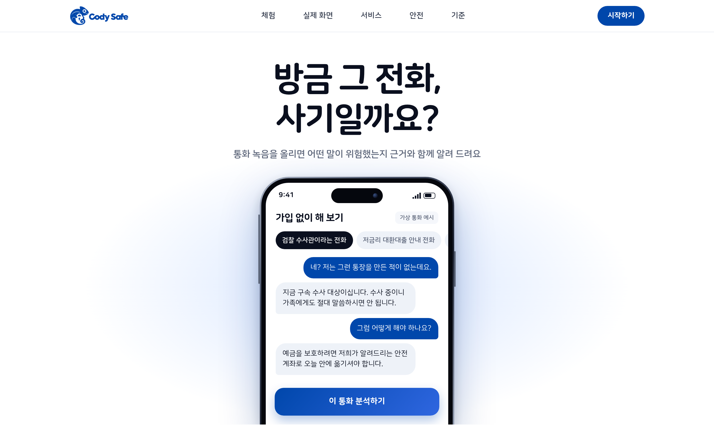
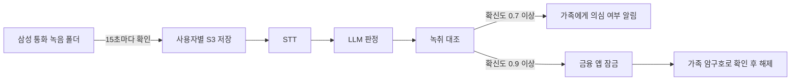
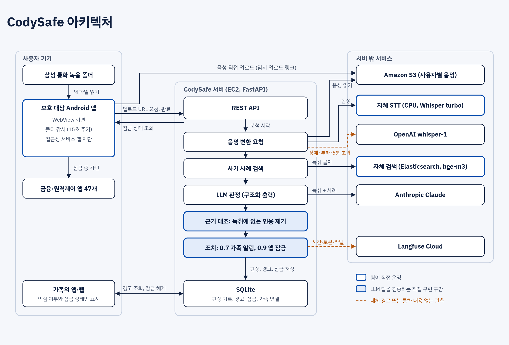
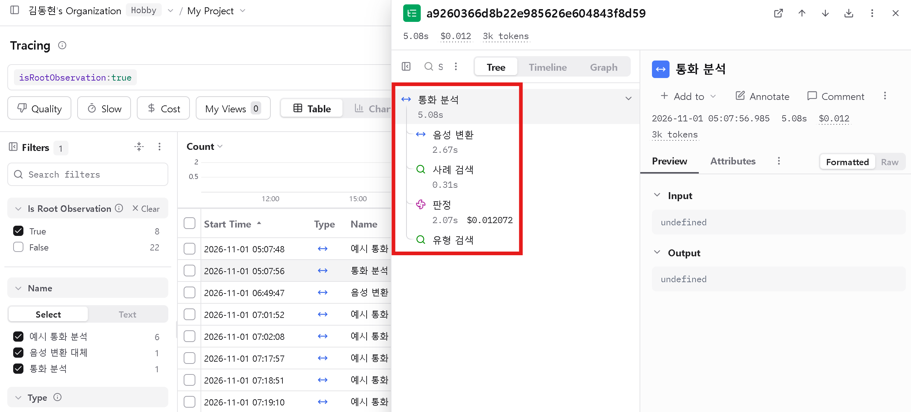
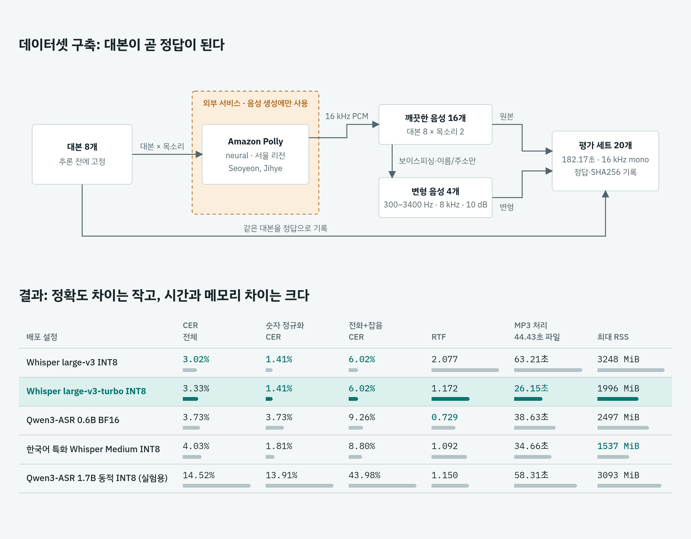

# CodySafe

> 통화 후 2차 피해를 가족과 함께 막는 AI 사기 대응 서비스
>
> 코디세이 AI 해커톤 2026 · 팀 유레카 · 주제 02 「AI 기반 정보보호 서비스」

보이스피싱은 전화가 끝난 뒤에도 이체와 앱 설치로 이어집니다. CodySafe는 통화 녹음을 분석해 본인에게 근거를 보여 주고, 가족에게 의심 여부만 알리고, 금융 앱을 잠가 추가 피해를 줄입니다.

- **대상:** 보이스피싱에 노출된 사용자와 그 가족
- **범위:** 일반 앱은 통화 음성을 실시간으로 받을 수 없어 통화 후 분석합니다. 이유는 [기획서](docs/family-guard-plan.md#2-왜-실시간-통화-분석을-하지-않는가)에 있습니다.
- **상태:** 실제 안드로이드 폰에서 녹음 분석부터 금융 앱 차단까지 동작하는 프로토타입입니다. 판정은 합성 통화로만 평가했고, 실제 통화 탐지율은 아직 측정하지 않았습니다. [구현 상태](#구현-상태)를 함께 봐 주세요.
- **시연:** <http://54.116.173.130:8091/> (앱 화면은 [/app/](http://54.116.173.130:8091/app/)). 시연 가족 계정은 누구나 같은 기록을 보므로 실제 통화를 올리지 마세요.



## 동작 흐름



## 아키텍처



### Langfuse



### STT 모델 선정

Amazon Polly로 합성한 한국어 음성 20개로 5개 설정을 비교해 `whisper-large-v3-turbo` INT8을 골랐습니다. 합성 음성으로 한 번씩 측정한 예비 평가이며, 자세한 내용은 [비교 보고서](korean-stt/docs/한국어_STT_모델_비교_평가_2026-11-01.md)에 있습니다.



## 주요 기능

| 기능 | 내용 |
|---|---|
| 통화 검사 | 새 녹음을 자동으로 STT 변환해 판정합니다. 웹은 파일 업로드 방식입니다. |
| 근거 표시 | 판정 근거 문장을 녹취와 대조해, 통화에 실제로 있는 말만 보여 줍니다. |
| 가족 알림 | 초대 코드로 연결하며, 가족에게는 의심 여부와 잠금 상태만 전달합니다. |
| 금융 앱 잠금 | 강한 의심 시 은행, 카드, 간편결제, 증권, 원격제어 앱 47개를 막고 경고합니다. |
| 가족 암구호 | 연결된 가족이 매일 바뀌는 단어로 본인을 확인합니다. |
| 사기 체험 | 13개 시나리오를 대화형으로 연습합니다. |
| 커뮤니티 | 수법을 제보하고 추천합니다. 상위 3개는 AI 체험 시나리오로 만들 수 있습니다. |
| 피드백 | 사용자가 판정을 확인하면 AI 판정과 사람 판정을 데이터셋에 쌓습니다. |
| 대시보드 | 사용자가 자기 체험 점수와 약한 수법을 봅니다. |
| 코디와 가족 퀴즈 | 퀴즈 카드 15장과 가족 마스코트로 예방 습관을 만듭니다. 점수는 예방 행동에만 줍니다. |

## 구현 상태

| 부분 | 상태 |
|---|---|
| 녹음 업로드, STT, LLM 판정 | 구현, 실제 음성 파일로 확인 |
| 근거 대조, 가족 알림, 암구호, 커뮤니티 | 구현, 자동 테스트와 브라우저 시연으로 확인 |
| 사용자별 S3 저장 | 구현, 실제 버킷에 시험 파일로 확인 |
| 폴더 연결, 분석 후 경고, 금융 앱 차단 (Android) | 구현, 실제 폰 1대에서 녹화로 확인 ([영상](server/web/media/demo.mp4)) |
| 15초 감지 주기, 앱이 꺼진 뒤 주기 실행 (Android) | 구현, 주기와 지연은 미측정 |
| 사례 검색 (RAG) | 별도 Elasticsearch 검색 서버를 `GUARD_RAG_URL`로 연결하면 판정 전에 참고 자료로 넣음. 코드와 실행 방법은 [infra/es-server](infra/es-server/codysafe-rag/README.md)에 있음. 원본 데이터는 올리지 않아 재현에 데이터 폴더가 필요. 서버가 없어도 LLM만으로 동작. 내장 검색은 판정 뒤 유형 표시에 쓰며 벡터는 해시 임베딩. 합성 통화 60건에서는 판정 차이 없음 |
| 피드백, 사용자 대시보드 | 구현, 자동 테스트와 브라우저로 확인 |
| 재학습, 검색 색인 갱신 | 추후 과제 |
| 자체 STT (CPU, `whisper-large-v3-turbo` INT8) + OpenAI 대체 경로 | 구현. 실제 MP3 1건으로 실서버 전사부터 판정까지 확인. 대체 경로도 확인. 성능은 표본이 적어 근거로 쓰지 않음 |
| GPU 서빙 | 미구현 |
| 판정 평가 | 합성 통화 60건(`server/eval/`): 사기 30건 모두 탐지, 정상 30건 오탐 0건, RAG 유무 차이 없음. 평가셋이 합성이고 작아 95% 신뢰구간은 탐지율 88% 이상, 오탐률 12% 이하. 실제 통화 성능은 미측정 |

## 실행

```bash
git clone https://github.com/rla8127/CodySafe.git
cd CodySafe/server
python3 -m venv .venv && .venv/bin/pip install -r requirements.txt
.venv/bin/python -m pytest -q   # 71개, 외부 키 불필요
```

Python 3에서 확인했습니다.

키 없이 규칙 판정으로 실행합니다. `.txt` 파일을 녹취로 간주하는 테스트 모드입니다.

```bash
.venv/bin/uvicorn guard.app:app --port 8091
# http://localhost:8091/app/
```

실제 분석에는 `server/.env`가 필요합니다. 이 파일은 커밋되지 않습니다.

```bash
cp .env.example .env
```

`.env`에서 다음 값을 채웁니다.

```
ANTHROPIC_API_KEY=<키>
OPENAI_API_KEY=<키>
GUARD_LLM=anthropic
GUARD_STT=server
STT_BASE_URL=<자체 STT 서버>
STT_API_KEY=<키>
```

S3 설정과 전체 옵션, APK 빌드는 [실행 문서](docs/family-guard.md)에 있습니다.

- **PC 웹:** 왼쪽 메뉴와 접을 수 있는 모바일 미리보기로 표시합니다.
- **시연 가족:** 웹에서 등록된 가족 5명 중 한 명으로 들어갑니다. 누구나 같은 기록을 보므로 실제 통화를 올리지 않습니다. `GUARD_DEMO_FAMILY=0`이면 꺼집니다.

## 구조

```
server/guard/    API, 판정 파이프라인, RAG, 제보, 암구호
server/web/      웹 화면
server/tests/    자동 테스트
android/         WebView 앱, 폴더 감시, 금융 앱 차단
korean-stt/      자체 STT 서버, 모델 비교 평가 코드와 보고서
infra/es-server/ 사례 검색 서버 (Terraform, Elasticsearch, 검색 API, 색인 스크립트)
index.html, css/, js/, assets/   공용 화면 자원과 초기 웹 MVP
docs/family-guard-plan.md        기획서
docs/project-plan.md             초기 QR 판독 기획 (이번 제출 범위 아님)
```

## 데이터와 개인정보

- 통화 상대의 음성도 전송되므로 동의한 통화나 테스트 파일로만 사용합니다.
- 음성은 자체 STT 서버에서 먼저 처리해 외부 전송과 외부 의존을 줄입니다. GPU 서버 사용 제약으로 CPU에서 서빙하며, 부하나 장애 시에는 OpenAI로 전송됩니다. 글자 기록은 판정을 위해 Anthropic으로 전송됩니다.
- 시연 버킷은 미국 리전에 있습니다. 실제 서비스에는 국내 리전이나 국외 이전 고지, 서버 HTTPS가 필요합니다.
- 분석 내용은 본인만 조회합니다. 일상 통화의 글자 기록은 저장하지 않습니다.

## 팀

김병국, 김동현, 김호연, 유상우, 전선형

## 외부 자원

| 이름 | 용도 |
|---|---|
| Anthropic Claude (`claude-opus-5-5`) | 사기 판정, 재순위, 시나리오 생성 |
| faster-whisper, CTranslate2, Whisper large-v3-turbo | 자체 STT 서버 ([비교 보고서](korean-stt/docs/한국어_STT_모델_비교_평가_2026-11-01.md)) |
| Whisper large-v3, whisper-medium-komixv2, Qwen3-ASR 0.6B·1.7B | STT 비교 평가, 미채택 |
| OpenAI `whisper-1` | 음성 변환 대체 경로 |
| Amazon Polly | STT 평가용 한국어 음성 데이터셋 생성 |
| ElevenLabs | 자연스러운 음성 생성 |
| Amazon EC2 | 서비스 서버 `t4g.large`, STT 서버 `c7i-flex.large`, 검색 서버 `t4g.medium` 각 1대 |
| Amazon S3 | 음성 저장 |
| [Langfuse Cloud](https://us.cloud.langfuse.com/project/cmvwspomu005fad0e5vr8sgrq/traces) | 처리 시간, 토큰, 비용 관측. 통화 내용은 보내지 않음. 프로젝트 권한이 있어야 열림 |
| OpenAI `gpt-image-2` | 체험의 가상 인물 사진 3장 생성 |
| Elasticsearch 8.17.0, analysis-nori | 사기 사례 검색 서버 (선택) |
| BAAI/bge-m3, sentence-transformers, PyTorch | 검색 임베딩 |
| Anthropic `claude-haiku-5-5` | 검색 문서 분류와 구조화 |
| 금융당국 보도자료, KISA 118 상담 기반 합성 데이터, 금감원 공개 녹음 전사(KorCCVi, 내부 학습용으로 검색 결과에서 제외) | 검색 문서 원천 |
| Terraform, Docker | 검색 서버 구성 IaC 구성 |
| FastAPI, SQLite | 서버 |
| AndroidX WorkManager, DocumentFile | 앱 |
| 네이버 나눔스퀘어 라운드, SUIT 2.0.5, Lucide 0.460.0 | 폰트, 아이콘 |

**사전 보유 코드:** 웹 화면 코드(`index.html`, `css/`, `js/`, `assets/`)는 주제 공개(2026-10-30 11:00) 전인 2026-10-30 01시경 처음 작성됐습니다. 대회 규정에 따라 발표자료의 외부 자원 활용 내역에도 같은 내용을 적습니다.

사용한 사기 통계와 공식 경보의 출처는 앱 화면과 `server/web/trends.js`에 있습니다.

## 라이선스

이 저장소의 코드는 공공의 이익을 위해 [GNU AGPL-3.0](LICENSE)으로 공개합니다. 누구나 쓰고 고칠 수 있으며, 고친 코드를 배포하거나 네트워크 서비스로 제공하면 그 소스도 같은 라이선스로 공개해야 합니다. 외부 자원은 각자의 라이선스와 이용 조건을 따릅니다.
