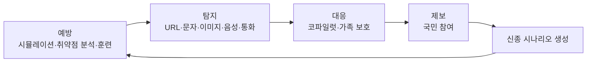

# CodySafe 기획안

> **AI 사기는 미리 경험하고, 피해도 미리 예방한다.**
>
> 코디세이 AI 해커톤 2026 · 팀 유레카 · 주제 02 「AI 기반 정보보호 서비스」

| 문서 상태 | 2026-10-31 기준 제안. 팀 합의 뒤 확정합니다. |
|---|---|
| 지금 동작하는 것 | 웹 화면 13개. 이 중 실제 판정 로직은 URL 탐지뿐이고, AI 모델은 아직 연결하지 않았습니다. |
| 이 문서의 표기 | **구현**은 코드가 있는 것, **시안**은 예시 데이터 화면, **계획**은 아직 만들지 않은 것입니다. |

## 한눈에 보기

| | |
|---|---|
| **문제** | 사기는 빠르게 바뀌는데, 사용자는 당하는 순간에야 처음 수법을 접합니다. |
| **해결** | 사기를 미리 체험하고, 의심될 때 바로 검사하고, 당했을 때 할 일을 안내받는 서비스 하나 |
| **대상** | 문자와 링크로 일상 업무를 처리하는 스마트폰 이용자, 부모님 폰을 챙기는 자녀 |
| **차별점** | 탐지에서 끝나지 않고 근거 설명, 대응 안내, 체험 훈련으로 이어집니다. 설치 없이 브라우저에서 열립니다. |

## 1. 문제 정의와 목표 사용자

### 문제

- **스미싱이 급증했습니다.** 탐지 건수가 2022년 37,122건에서 2024년 2,196,469건으로 늘었고, 3년 누적 중 공공기관 사칭이 59.4%, 청첩장·부고장 같은 지인 사칭이 15.5%입니다([금융위원회 보도자료](https://www.fsc.go.kr/no010101/83889)).
- **수법을 모르면 판단하기 어렵습니다.** 사칭 문자와 가짜 주소는 공식 안내와 비슷하게 만들어져, 처음 접하는 사람이 그 자리에서 가려내기 어렵습니다.
- **당한 뒤에 할 일이 흩어져 있습니다.** 지급정지, 신고, 명의도용 차단의 창구가 기관마다 다릅니다.

### 목표 사용자

1. 택배, 금융, 공공기관 문자를 자주 받는 스마트폰 이용자
2. 부모님이나 가족의 사기 피해를 걱정하는 자녀

## 2. 해결 방안과 주요 기능

**예방 → 탐지 → 대응** 세 단계로 묶습니다.



| # | 기능 | 단계 | 내용 | 상태 |
|---|------|------|------|------|
| 4 | AI 사기 시뮬레이션 | 예방 | 메신저형 대화 6종, 선택별 피드백과 점수 | 체험 동작, AI 생성 아님 |
| 6 | 개인 취약점 분석 | 예방 | 유형별 점수와 판단 패턴 | 시안 |
| 7 | 맞춤형 훈련 | 예방 | 취약 유형 기반 미션, 연속 기록 | 시안 |
| 13 | 방어 설정 점검 | 예방 | 흩어진 무료 방어 기능을 항목별로 안내 | 시안 (기기를 실제로 읽지 않음) |
| 10 | 스미싱·피싱 URL 탐지 | 탐지 | 공인 도메인 대조, 철자 유사도, 위험 점수 | **구현 (규칙 기반)** |
| 1 | AI 이미지 진위 분석 | 탐지 | 판별 근거와 의심 영역 표시 | 시안 |
| 2 | AI 음성 탐지 | 탐지 | 합성 확률과 음성 특징 근거 | 시안 |
| 3 | 실시간 통화 사기 탐지 | 탐지 | 자막과 위험도, 임계값 초과 시 경고 | 시안 |
| 11 | 기관 사칭 사실 검증 | 탐지 | 상대 주장과 공식 사실 대조 | 키워드 규칙, 고정 데이터 |
| 8 | 대응 코파일럿 | 대응 | 상황별 단계 안내, 112·1332·118 연결 | 고정 답변, LLM 미연결 |
| 9 | 가족 보호 네트워크 | 대응 | 가족 상태, 알림, 보호 설정 | 시안 |
| 5 | 국민 참여형 제보 | 순환 | 필터, 추천, 검증 상태, 작성 시트 | 시안 (저장 안 됨) |
| 12 | 신종 시나리오 자동 생성 | 순환 | 제보를 훈련 시나리오로 바꾸는 흐름 | 시안 |

### 기존 서비스와의 차이

공개 자료에서 확인한 범위입니다. 안내에 없다고 기능이 없다고 단정하지 않으며, 발표 전에 직접 설치해 확인합니다.

| 서비스 | 확인한 내용 | CodySafe가 더하려는 것 |
|---|---|---|
| [SKT 에이닷 전화](https://news.sktelecom.com/224228) | 통화 중 보이스피싱 탐지, 보호자 알림 | 알림 뒤 대응 안내, 사전 체험 훈련 |
| [KT 후후](https://www.etnews.com/20251223000189) | 온디바이스 보이스피싱 탐지 | 통신사와 무관하게 브라우저에서 사용 |
| [경찰청 시티즌코난](https://m.boannews.com/html/detail.html?idx=124631) | 악성 앱·원격제어 앱 탐지 | 수법 체험, 판별 근거 설명 |

통화와 기기 내부를 직접 검사하는 일은 통신사와 전용 앱이 유리합니다. CodySafe는 이를 대체하기보다 **사전 훈련과 사후 대응**에 집중합니다.

## 3. AI 기술과 직접 개발 범위

| 부분 | 내용 | 상태 |
|---|---|---|
| URL 규칙 엔진 | 공인 도메인 대조, 편집거리, 동형문자, 브랜드 사칭, TLD·경로·문구 점수 | **구현** |
| 문자 문맥 분류 | 링크 없는 사칭 문자까지 판별하는 한국어 모델 파인튜닝. 기반 모델 후보는 KoELECTRA-small | 계획 |
| 기기 내 추론 | 양자화한 ONNX 모델을 브라우저에서 실행해 문자 내용을 서버로 보내지 않는 구조 | 계획 |
| 「찍기 전에」 QR 판독 | 덧댄 QR 스티커 탐지, 인쇄물과 도메인 대조, URL 분류 모델 ([팀 기획안](docs/project-plan.md)) | 계획 |
| 이미지 개인정보 가리기 | OCR과 규칙으로 주민번호·계좌 등을 찾아 검은 박스 처리 | 후보 |

### 평가 계획

- **비교 기준:** 지금의 규칙 엔진 대비 모델의 탐지율과 **정상 문자 오탐률**
- **평가 데이터:** 학습에 쓰지 않은 실제 사례 중심으로 먼저 고정합니다. 합성 데이터로만 평가한 수치는 성능 근거로 쓰지 않습니다.
- **결과:** 측정 뒤 이 문서에 적습니다. 측정 전에는 성능 수치를 말하지 않습니다.

### 알려진 한계

- 결과 화면의 도메인 생성일, KISA 신고 건수, 인증서 상태는 실제 조회값이 아닌 고정 표시입니다. KISA와 WHOIS 조회도 분석 단계 문구로만 나옵니다. 시연 전에 고치거나 제거합니다.
- 공인 도메인 목록은 20개뿐인 예시이며, 목록에 없는 사이트는 정상이어도 "주의"로 나옵니다.
- 화면에 보이는 점수, 통계, 사용자 이름은 모두 예시입니다.
- 웹이라 들어오는 문자를 자동으로 읽지 못하며, 사용자가 붙여넣어야 합니다.

### URL 판정 구조 (서비스 단계)

URL 판정은 공인 목록에 있는지, 공인 도메인과 얼마나 비슷한지를 따지는 정확 매칭 문제라 RAG보다 관계형 DB가 맞습니다.

```
입력 URL → 도메인 정규화(punycode·www·서브도메인 제거)
  ├─ 화이트리스트(RDB): 정부, 공공, 금융위 등록 금융사, 주요 기업
  ├─ 블랙리스트(RDB/Redis): KISA 피싱 DB, 경찰청 신고, 검증된 사용자 제보
  ├─ 유사도 엔진: 편집거리, 동형문자, 브랜드명 포함 여부
  ├─ 평판: WHOIS 생성일, 의심 TLD, SSL, 단축 URL 펼치기
  └─ 문맥 모델: 문자 본문의 사기 표현 판단
```

## 4. 개발 환경과 기술 스택

| 구분 | 사용 기술 | 상태 |
|---|---|---|
| 화면 | 정적 HTML/CSS/JS, 해시 라우터 | **구현** |
| 학습 | PyTorch, 대회 제공 GPU 서버(NVIDIA L4 24GB) | 계획 |
| 브라우저 추론 | ONNX, Transformers.js | 계획 |

### 실행

```bash
git clone https://github.com/rla8127/CodySafe.git
cd CodySafe
python3 -m http.server 8090
# http://localhost:8090
```

- 데스크톱에서는 소개 패널과 폰 목업이, 폭 500px 이하에서는 앱 형태의 전체 화면이 나옵니다.
- 폰트와 아이콘을 CDN에서 불러오므로 인터넷 연결이 필요합니다.
- 위 명령은 `.git`을 포함한 폴더 전체를 내보내므로 로컬 확인용으로만 쓰세요.

### 구조

```
index.html          진입점
css/style.css       디자인 토큰 + 전체 스타일
js/data.js          예시 데이터
js/app.js           라우터, 화면, 인터랙션, URL 규칙 엔진
assets/             로고, 배지 (자체 디자인, 공식 정부 상징 아님)
docs/project-plan.md        「찍기 전에」 QR 판독 상세 기획안
docs/team-plan-readme.md    위 기획의 소개 문서
docs/brand/         브랜드 가이드와 로고
```

## 5. 팀 역할

역할과 담당자는 [상세 기획안 6절](docs/project-plan.md#6-팀원별-역할-분담-ⓔ)의 제안을 기준으로 팀 확인 뒤 확정합니다.

## 6. 외부 자원

대회 규정에 따라 사용한 자원을 모두 적습니다. 아래는 현재 코드 기준이며, 추가할 때마다 한 줄씩 적습니다.

| 자원 | 버전 | 용도 | 출처 | 라이선스 |
|---|---|---|---|---|
| Pretendard | 1.3.9 | 폰트 | jsDelivr CDN | 확인 후 기재 |
| Lucide | 0.460.0 | 아이콘 | unpkg CDN | 확인 후 기재 |
| Claude Code | - | 코드·문서 초안 | Anthropic | 서비스 약관 |
| CodySafe 웹 화면 | - | 플랫폼 화면 | 팀 | 제작 시점과 재사용 범위를 확인해 기재 |

## 7. 기대 효과와 확장

- **개인:** 처음 보는 수법을 실제 피해 전에 경험하고, 의심될 때 근거를 보고 판단합니다.
- **가족:** 혼자 판단하기 어려운 가족을 함께 돕습니다. 가족끼리 정한 암호로 사칭을 확인하는 기능을 후보로 둡니다.
- **사회:** 제보가 훈련 시나리오로 돌아오는 구조를 목표로 합니다.

효과 수치는 아직 없으며, 측정 전에는 주장하지 않습니다.

## 라이선스

팀이 정하기 전입니다. 외부 자원은 각 라이선스를 따릅니다.
