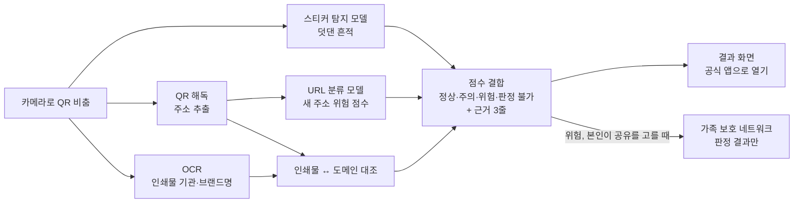

# CodySafe — 가족이 함께 지키는 AI 사기 예방 플랫폼

> 코디세이 AI 해커톤 2026 · 팀 유레카 · 주제 02 「AI 기반 정보보호 서비스」
>
> 첫 모듈 **「찍기 전에」**: QR을 찍기 전에, 덧붙인 가짜 스티커와 가짜 주소를 AI가 먼저 봅니다.

**상태: 기획 초안, 개발 시작 전 (2026-10-31 기준).** 아직 실행할 수 있는 코드가 없습니다. 아래 [구현 상태](#구현-상태) 표에 부분마다 계획 / 화면 시안 / 구현 / 실측 검증을 적고, 제출(2026-11-01 13:00) 전까지 실제 상태로 고칩니다. 역할·일정·플랫폼 방향은 팀 합의 전 제안입니다. 자세한 기획은 [docs/project-plan.md](docs/project-plan.md)에 있습니다.

## 한눈에 보기

- **문제:** 공유 킥보드·주차 고지서·공공 안내문의 정상 QR 위에 가짜 QR 스티커를 덧붙여 피싱 사이트로 보내는 '큐싱'. 지금의 확인 도구는 QR 속 주소를 검사합니다. 우리가 확인한 공식 안내에서는 인쇄물 위에 덧댄 스티커나 인쇄된 글자를 보는 기능 설명을 찾지 못했습니다.
- **해결:** QR을 열기 전에 세 신호를 함께 봅니다. ① 덧댄 스티커 탐지 ② 인쇄물 글자(기관·브랜드 이름)와 QR 속 실제 도메인 대조 ③ 알려진 목록에 없는 새 주소의 위험 점수(팀이 직접 학습하는 URL 분류 모델)
- **결과:** 정상 / 주의 / 위험 3단계 + 근거 3줄 + '공식 앱으로 열기'. 스캔 실패·글자 인식 불확실·서버 오류는 '정상'이 아니라 '판정 불가'로 표시합니다.
- **가족:** 보호자에게는 판정 결과(등급·일반화한 근거·시각)만 보내는 것이 목표입니다. 사진과 주소 원문은 가족 공유에 넣지 않습니다.
- **사용자:** QR을 자주 찍는 20–50대 스마트폰 이용자, 그리고 부모님 폰을 챙기는 자녀

## 왜 필요한가

- 정부 합동 주의보에 "공유형 킥보드에 부착된 정상 QR코드 위에 큐싱 스티커를 덧붙이"는 유형이 나옵니다([개인정보보호위원회 관계부처 합동 보도자료, 2024-10-23](https://pipc.go.kr/np/cop/bbs/selectBoardArticle.do?bbsId=BS074&mCode=C020010000&nttId=10698)).
- 스미싱 탐지 건수는 2022년 3.7만 건에서 2024년 219.6만 건으로 늘었고, 3년 누적 중 공공기관 사칭이 59.4%입니다([금융위원회 보도자료](https://www.fsc.go.kr/no010101/83889)). 스미싱 전체 통계이며, 큐싱만의 피해 규모는 아닙니다.
- 같은 자료에 따르면 KISA 보호나라는 QR 사진을 분석해 10분 안에 회신합니다. 길에서 QR을 찍으려는 순간에는 기다리기 어렵습니다.

## 기존 서비스와 다른 점

각 회사 공식 안내(2026-10-31 확인)에서 본 범위입니다. 안내에 없다고 기능이 없다고 단정하지는 않습니다.

| 서비스 | 공식 안내에서 확인한 것 | 안내에서 찾지 못한 것 (「찍기 전에」가 더하려는 것) |
|---|---|---|
| [KT 안심 QR](https://inside.kt.com/html/safety/secure_QR.html) | 스캔한 주소를 스미싱 DB 등으로 판정, "스티커가 덧붙여졌는지 확인하라"는 예방 수칙 | 덧댄 스티커 탐지, 인쇄물 글자 ↔ 도메인 대조 |
| [카스퍼스키 QR Scanner](https://support.kaspersky.com/QRSAndroid/1.3/en-us/94042.htm) | QR 해독, URL 검사, 미리보기, 악성·피싱 알림 | 위와 같음 |
| [안랩 V3 Mobile Security](https://www.ahnlab.com/ko/product/v3-mobile) 'QR코드 검사' | 콘텐츠 유형이 URL이면 악성 여부 검사 | 위와 같음 |
| KISA 보호나라 (위 금융위원회 자료) | QR 사진을 분석해 10분 안에 회신 | 찍는 순간 판정(처리 시간은 실측 뒤 기재) |

## 동작 흐름 (계획)



- 판정은 단정하지 않습니다. 스티커가 보이거나 주소가 낯설다는 것 하나로 '피싱'이라 하지 않고, 세 신호를 합쳐 '주의'와 '위험'을 나눕니다. '정상'은 '안전 보증'이 아니라 '드러난 위험 신호 없음'입니다.
- **데이터가 어디로 가나:** 판정을 서버에서 하면 사진이나 주소가 판정 서버로 전송될 수 있습니다. 기기 안 처리 범위, 서버로 가는 항목, 보관 여부는 구현한 뒤 확인해서 여기에 적습니다. 확인 전에는 '원문이 기기 밖으로 나가지 않는다'고 말하지 않습니다.

## 구현 상태

2026-10-31 기준입니다. 상태는 계획 → 화면 시안 → 구현 → 실측 검증 순서로 바뀝니다. CodySafe 화면 번호는 지금 웹 시안의 '기능 N' 표시를 따릅니다.

| 부분 | 내용 | 상태 |
|---|---|---|
| QR 해독 | 카메라 사진에서 주소 꺼내기 | 계획 |
| URL 분류 모델 | 목록에 없는 새 주소의 위험 점수 | 계획 |
| 스티커 탐지 모델 | QR 둘레의 덧댄 흔적 | 계획 |
| 인쇄물 ↔ 도메인 대조 | OCR + 기관·브랜드 사전 | 계획 |
| 점수 결합·결과 화면 | 정상·주의·위험·판정 불가 + 근거 3줄, 공식 앱으로 열기 | 계획 (화면 틀은 기능 10 'QR 코드' 탭 시안이 있음) |
| 문자·링크 검사 | 기능 10 '문자·링크' 탭에 같은 URL 분류 모델 | 계획 (탭 시안 있음) |
| 가족에게 결과 보내기 | 기능 9 '가족 보호 네트워크'에 판정 결과만 | 계획 · 2026-11-01 06:00까지 안 되면 확장 계획으로 |
| 브라우저 대체 경로 | 서버가 멈춰도 브라우저 안 모델로 판정 | 계획 · 검증된 범위만 주장 |
| 기능 2 AI 음성 탐지, 4 AI 사기 시뮬레이션, 5 국민 참여형 사기 제보, 6 개인별 취약점 분석, 8 AI 사기 대응 코파일럿, 12 신종 사기 시나리오 자동 생성 | CodySafe 플랫폼 화면 | 화면 시안(예시 데이터) · 이번 제출에서 AI 동작을 주장하지 않음 · 확장 계획 |

## 저장소 구조 (예정)

폴더마다 담당자를 정하고, 담당자가 그 폴더의 산출물을 책임집니다. 함께 고친 것과 리뷰도 커밋·기록으로 남깁니다.

```
CodySafe/
├─ README.md
├─ docs/
│  └─ project-plan.md     # 기획안 (발표자료의 근거 문서)
├─ web/                   # CodySafe 화면 (기능 9·10 연결)
├─ server/                # 판정 API (/scan, /share)
├─ ml/
│  ├─ url_classifier/     # 데이터 내려받기·전처리·학습·평가
│  ├─ sticker_detector/   # 합성 데이터 생성기·학습·평가
│  └─ ocr_match/          # 기관·브랜드 사전, 도메인 대조
├─ demo/                  # 로컬 모의 피싱 페이지 (시연 전용)
└─ data/                  # 원본은 올리지 않음. 내려받기 스크립트와 파일 해시만
```

## 설치·환경설정·실행

> **지금은 실행할 수 있는 코드가 없고, 아래는 미완성 틀입니다.** 제출 전에 실제 코드 기준으로 채우고, 새 환경에서 처음부터 따라 해 확인합니다. 채울 것: 지원 OS, Python·Node 버전, 의존성 설치 명령, 환경 변수 이름과 필수 여부, 모델 가중치 받는 법, 서버·화면 실행 명령, 접속 주소, 정상 동작 확인 방법. 시연 실행에는 재학습이 필요 없게 하고, 학습 재현은 따로 적습니다.

1. 저장소 받기: `git clone https://github.com/rla8127/CodySafe.git`
2. 환경 변수: `.env.example`을 `.env`로 복사해 값을 채웁니다. **API 키와 비밀번호는 커밋하지 않습니다.**
3. 데이터 받기: (미완성)
4. 모델 가중치 받기 또는 학습 재현: (미완성)
5. 서버 실행: (미완성)
6. 화면 실행과 확인: (미완성)

## 데이터와 공개 범위

| 데이터 | 출처 | 저장소에 올리는 것 |
|---|---|---|
| 피싱 사이트 URL | [한국인터넷진흥원 피싱사이트 URL (공공데이터포털)](https://www.data.go.kr/data/15143094/fileData.do), 이용허락범위 제한 없음(포털 표기, 2026-10-31 확인) | 내려받기·전처리 스크립트와 파일 해시만 (원본 URL 목록은 올리지 않음) |
| 정상 URL 정답셋 | 공공기관·공유 킥보드·주차 앱 공식 도메인 등 (팀 작성) | 목록과 만든 기준 |
| 스티커 사진 | 목표: 합성 5천 장 + 실사 50장 (만든 사람 ≠ 시험한 사람) | 합성 생성기, 시험 결과, 실제로 모은 수 |

- 실제 피싱 주소에는 접속하지 않습니다. 학습에는 URL 문자열만 씁니다.
- 사용자가 넣은 주소나 실제 피싱 주소를 서버가 대신 열어 보는 기능은 이번 MVP에 없습니다. 링크 미리보기는 팀이 만든 로컬 모의 페이지에서만 시연합니다.

## 평가 계획

| 대상 | 방법 | 비교 기준 |
|---|---|---|
| URL 분류 모델 | 시간 분할: 앞 기간 주소로 학습, 뒤 기간 주소로 시험. 등록 도메인이 학습·검증·시험에 겹치지 않게 나누고, 판정 기준값은 검증셋에서만 정함 | ① 학습 시점 목록과의 문자열 정확 일치(그 목록에 없는 주소는 정의상 못 잡음. 상용 서비스의 탐지율이 아님) ② 길이·특수문자 규칙 ③ 외부 LLM에 바로 묻기 |
| 스티커 탐지 모델 | 합성 사진으로 학습, 실사 사진으로만 시험. '스티커가 있음'과 '사기임'의 정답을 따로 매김 | 공식 안내에서 찾지 못한 기능이라 기준선은 '탐지 없음' |
| 전체 판정 | 같은 시험 사례에서 URL만 / URL+인쇄물 대조 / 세 신호 전체를 비교해 위험 탐지와 정상 오탐을 보고 | |
| 처리 시간 | 휴대폰 화면에서 실측 | 실측 전에는 숫자를 말하지 않음 |

시험셋(사진 수, 촬영 조건, 날짜 경계, 표본 수)은 시험 전에 고정하고, 고정한 시험셋으로는 조정하지 않습니다. 결과 표는 측정 뒤 여기에 적습니다.

## 팀

역할은 2026-10-31 기준 제안이며, 팀 확인 뒤 이름과 함께 확정합니다.

| 역할 | 맡는 일 |
|---|---|
| 프로덕트 매니저 (팀장) | 일정·멘토 협의·제출, 발표 |
| ML 인프라·모델 서빙 | GPU 환경, 스티커 탐지 모델, 판정 API 서빙, CodySafe 화면 연결 |
| 백엔드 | 판정 결합 API, 인쇄물 대조, 가족 공유, 로컬 모의 피싱 페이지 |
| 프로덕트 디자인·프론트엔드 | 결과 화면, 시연 소품·실사 사진, 영상 콘티 |
| ML·평가 | URL 분류 모델, 평가 설계, 외부 자원 표 |

## 외부 자원

사용한 외부 데이터·모델·가중치·라이브러리·아이콘·AI 코딩 도구는 발표자료 ⓕ 표와 [docs/project-plan.md](docs/project-plan.md) 7절 '외부 자원 활용 내역'에 한 줄씩(명칭·버전·출처·용도·라이선스) 적습니다(대회 규정). 이 README와 기획안 초안 작성에도 AI 도구를 썼고, 같은 표에 적습니다.

## 라이선스

팀이 정하기 전입니다. 외부 모델·데이터는 각 라이선스를 따릅니다.
