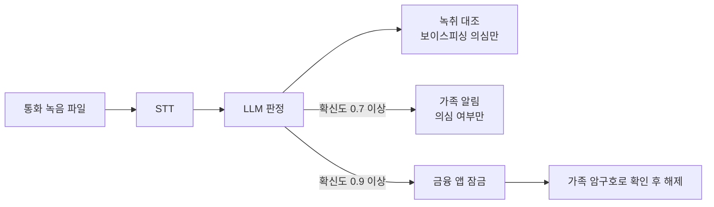

# CodySafe 가족보호 기획서 — 통화 후 사기 탐지와 후속 조치

이 문서는 통화 녹음 기반 가족보호 기능의 기획을 다룹니다. QR 판독 기획은 [project-plan.md](project-plan.md)를, 실행 방법은 [family-guard.md](family-guard.md)를 봅니다.

수치와 상태는 2026-10-31 기준이며, 측정하지 않은 값은 "미측정"으로 적습니다.

## 1. 문제와 해결

보이스피싱 피해는 통화가 끝난 뒤에도 이체와 앱 설치로 이어질 수 있고, 가족은 그 사실을 바로 알기 어렵습니다. 이 기능은 통화 녹음을 분석해 본인에게 근거를 보여 주고, 가족에게 의심 여부만 알리며, 추가 피해를 막는 조치까지 연결합니다.

## 2. 왜 실시간 통화 분석을 하지 않는가

**일반 Android 앱은 통화 음성을 받을 수 없기 때문입니다.** 연산 성능이 아니라 운영체제 권한과 스토어 정책의 문제입니다. 제조사와 통신사의 실시간 탐지가 가능한 것과는 조건이 다릅니다.

| 방법 | 막히는 이유 | 근거 |
|---|---|---|
| 통화 음성 직접 캡처 (`VOICE_CALL`) | `CAPTURE_AUDIO_OUTPUT` 권한이 필요하며, 이 권한은 사전 설치된 특권 앱만 쓸 수 있음 | [AudioSource](https://developer.android.com/reference/android/media/MediaRecorder.AudioSource), [오디오 입력 공유](https://developer.android.com/media/platform/sharing-audio-input) |
| 일반 앱이 통화 중 마이크 녹음 | 통화 중에는 통화 앱이 입력을 받고, 일반 앱은 무음을 받음 | [오디오 입력 공유](https://developer.android.com/media/platform/sharing-audio-input) |
| 접근성 서비스로 우회 | 시스템상 가능한 경우가 있어도 Google이 2022-05-11부터 통화 녹음 용도를 금지함. 상대방 음성 품질도 보장되지 않음 | [Tom's Guide 보도](https://www.tomsguide.com/news/google-killing-call-recording-apps-may-11) |
| 기본 전화 앱으로 지정 | 전화 앱으로 지정하는 것만으로는 부족함. Google 안내는 "기본 전화 앱이면서 사전 설치된 앱"을 조건으로 듦 | [Tom's Guide 보도](https://www.tomsguide.com/news/google-killing-call-recording-apps-may-11) |
| 삼성 통화 녹음 파일 읽기 | 녹음 파일을 읽는 방식이라 통화가 끝나 파일이 저장된 뒤에야 분석할 수 있음 | 현재 구현 방식 |

### 실시간 탐지를 하는 서비스와의 차이

과학기술정보통신부 권장 사례로 보도된 서비스는 제조사나 통신사가 제공합니다([아시아경제, 2026-02](https://view.asiae.co.kr/article/2026021215253365891)). 보도에 따르면 모두 기기 안에서 분석합니다.

| 서비스 | 제공 주체 | 보도된 내용 |
|---|---|---|
| 삼성 전화 | 제조사 | 통화 내용을 분석해 의심·감지 2단계로 경고 |
| 에이닷 전화 | SKT | 키워드와 대화 패턴을 분석해 의심·위험 2단계로 구분 |
| 후후 | KT | 위 보도에서 함께 소개됨 |
| 익시오 | LG유플러스 | 안티딥보이스로 음성 위변조 여부를 검사 |

### 우리가 택한 범위

- **통화 후 분석으로 한정합니다.** 이체 전 차단을 보장하지 않으며, 통화 후 추가 이체와 2차 피해를 줄이는 것을 목표로 합니다.
- **실시간 탐지와 경쟁하지 않고 그 뒤를 맡습니다.** 탐지 뒤의 가족 알림, 금융 앱 잠금, 가족 암구호가 핵심입니다. 위 서비스에 비슷한 후속 기능이 있는지는 아직 확인하지 않았습니다.
- **실시간으로 확장하려면** 제조사나 통신사와 협력해야 합니다.

## 2-1. 체험 시나리오

사기 수법 시나리오 13개를 대화형 선택으로 체험합니다. 대사는 팀이 쓴 가상 예시이며 평가 근거가 아닙니다.

## 2-2. 커뮤니티 제보와 훈련 생성

이용자가 수법을 제보하고 추천합니다. 추천 상위 3개는 LLM으로 5턴 체험 시나리오를 만들 수 있습니다. 새 수법이 제보될수록 훈련이 함께 늘어나는 구조이며, 제보가 들어와야 동작합니다.

- 제보는 사실 확인 전 글이며, 추천 수는 공식 피해 통계가 아닙니다.
- 전화번호, 계좌번호, 링크는 저장 전에 가리고, 작성자는 공개하지 않습니다. 이름이나 민감한 사연까지 자동으로 걸러 내지는 못합니다.
- 생성은 상위 제보만, 제보당 한 번만 합니다. 결과의 구조를 검사하고 번호와 링크를 다시 가립니다.
- 한 기기당 하루 5건, 제보당 1기기 1추천입니다. 기기 등록이 자유로워 추천 조작을 막지 못하며, 관리자 검수 기능은 없습니다.

## 2-3. 피드백 루프

| 단계 | 구현 |
|---|---|
| 대응 기록 | 체험 점수, 잠금과 해제, 가족 경고 발송과 확인 |
| 사람 확인 | 사용자가 결과 카드에서 판정이 맞는지 표시 |
| 데이터셋 | AI 판정과 사람 판정을 라벨로 저장. 정상 통화의 글자 기록은 남기지 않음 |
| 사용자 대시보드 | 본인의 체험 평균과 약한 수법, 다음 추천 |
| 다음 훈련에 반영 | 최근 점수가 낮은 시나리오를 규칙으로 추천 |
| 재학습, 색인 갱신 | 추후 과제 |

오탐률은 사용자가 확인한 건만 기준으로 하므로 편향될 수 있고, 30건 미만이면 참고용으로 표시합니다. 가족에게는 대시보드 내용을 공유하지 않습니다.

## 3. 판정 표시 원칙

| 항목 | 화면 표시 | 근거 수준 |
|---|---|---|
| 판정 | "보이스피싱 의심" 등 | AI 판단이므로 단정하지 않음 |
| AI 판단 확신도 | 막대와 퍼센트 | LLM이 스스로 매긴 값. 보정하지 않았으므로 사기 확률이 아님 |
| 녹취에서 확인한 말 | 통화에서 실제로 나온 말 (보이스피싱 의심일 때만) | 서버가 녹취와 글자를 대조. 말한 내용의 진실 여부나 STT 오류까지 보증하지 않음 |
| 비슷한 수법, 확인 방법 | 같은 박스 안 별도 칸 | 팀이 작성한 일반 설명. 공식 출처 대조 전 |
| AI 요약 | 표시하지 않음 | 녹취와 자동 대조할 수 없음 |

- 녹취에서 확인되는 발화가 없는 보이스피싱 판정은 "판단 어려움"으로 낮추고, 가족 알림과 잠금을 하지 않습니다.
- 보이스피싱이 아닌 판정은 근거 대조 없이 한 줄로 표시합니다.
- 가족에게는 의심 여부와 잠금 상태만 보이고, 확신도와 통화 내용은 보이지 않습니다.
- 최근 사건과 통계는 LLM이 쓰지 못하게 금지했습니다. 넣으려면 공식 자료를 출처와 함께 저장한 뒤 인용해야 합니다.
- 확률이라고 부르려면 라벨이 있는 평가셋으로 보정해야 합니다.

## 4. 후속 조치

| 기능 | 조건 | 해제 또는 동작 |
|---|---|---|
| 가족 알림 | 보이스피싱 확신도 0.7 이상 | 의심 여부만 전달 |
| 금융 앱 잠금 | 확신도 0.9 이상 또는 본인이 직접 잠금 | 가족은 즉시 해제, 본인은 10분 대기 후 해제, 기본 1시간 뒤 자동 해제 |
| 가족 암구호 | 가족 연결 시 | 매일 0시(한국 시간) 변경, 폰을 잃은 경우를 위한 비상 암구호 |

잠금은 은행, 카드, 간편결제, 증권, 원격제어 앱 47개를 앱 ID로 판별합니다. 접근성 권한을 끄거나 앱을 지우면 막을 수 없고, 스토어 밖 설치에서는 Play 보호가 설치를 막을 수 있습니다. 실제 배포에는 Play 심사가 필요합니다.

## 5. 처리 경로

| 경로 | STT | LLM | 음성이 외부로 나가는가 | 상태 |
|---|---|---|---|---|
| 평상시 | 자체 서버 CPU `whisper-large-v3-turbo` (INT8) | Anthropic | 음성은 안 나감, **녹취 글자는 나감** | 구현, 실제 MP3 1건으로 확인 |
| 부하·장애 시 | OpenAI `whisper-1` | Anthropic | 나감 | 구현 |

- 앱은 15초마다 삼성 녹음 폴더를 확인하고, 저장이 끝난 새 파일을 S3의 `recordings/{기기 ID}/`로 직접 올립니다. `GUARD_KEEP_AUDIO=1`이면 음성을 분석 뒤에도 보관하며, 사용자가 기록을 지우면 함께 삭제합니다. 끄면 분석 후 삭제합니다.
- 앱에서 S3까지는 HTTPS지만, 앱·브라우저와 서버 사이는 아직 HTTP입니다. 실제 음성을 다루려면 HTTPS가 필요합니다.
- 시연 버킷은 미국 리전(us-east-1)에 있습니다. 실제 서비스에서는 국내 리전으로 옮기거나 국외 이전 고지가 필요합니다.

### 왜 이 구조인가

- **자체 STT를 둔 이유:** 통화 음성을 외부 서비스에 보내지 않고 우리 서버 안에서 처리하고, 외부 의존도를 낮추기 위해서입니다.
- **CPU로 서빙한 이유:** GPU 서버는 현실적으로 사용에 제약이 있어 INT8 양자화 모델을 CPU에서 돌립니다.
- **대체 경로를 둔 이유:** CPU 서버는 전사를 한 번에 1건만 처리하고 음성 300초까지만 받습니다. 부하나 장애로 분석이 멈추면 사기 대응도 멈추므로, 이때만 OpenAI `whisper-1`을 호출합니다.
- **대가:** 대체 경로를 탄 음성은 외부로 나갑니다. "음성이 절대 외부로 나가지 않는다"고 말하지 않습니다. 끄려면 `STT_FALLBACK=none`입니다.

## 6. STT 후보

한국어 통화 음성의 공개 벤치마크는 찾지 못했습니다. 아래 수치는 영어 중심 순위표나 소규모 비교이므로 직접 측정한 값으로 판단합니다.

| 모델 | 찾은 근거 | 역할 |
|---|---|---|
| Whisper large-v3-turbo (faster-whisper) | 소규모 한국어 비교 CER 약 5.5~6% | 기본 선택 |
| Qwen3-ASR | 영어 중심 순위표 WER 4.95%, 한국어 지원 | 비교 후보 |
| Cohere Transcribe | Apache 2.0, 한국어 지원, 같은 순위표 WER 5.42% | 비교 후보 |
| Whisper large-v3 | 같은 순위표 WER 7.44% | 후순위 |

출처: [Northflank](https://northflank.com/blog/best-open-source-speech-to-text-stt-model-in-2026-benchmarks), [Spokenly](https://spokenly.app/blog/cohere-transcribe), [Open Ko-S2S 인사이트](https://baryonlabs-open-ko-s2s-insights.static.hf.space/index.html), [Apple STT vs Whisper 비교](https://github.com/doongdoong-ai/doongdoong/issues/12)

## 7. L4 GPU 활용 계획과 측정 결과

| 순위 | 작업 | 서비스에서의 쓰임 | 상태 |
|---|---|---|---|
| 1 | STT GPU 서빙 | 처리 속도를 높이고 대체 경로 사용을 줄임 | 계획. 현재는 CPU 서빙 |
| 2 | TTS로 시연 음성과 평가셋 생성 | 음성부터 판정까지 전체 평가 | 계획 |
| 3 | 임베딩·리랭커 자체 호스팅 | 해시 임베딩 대체 | 계획 |
| 4 | STT 파인튜닝 | 기본 모델보다 나을 때만 교체 | 선택 |

| 측정 항목 | 결과 |
|---|---|
| 음성 1분당 처리 시간 | CPU 약 70초 (RTF 1.17, 합성 음성 20개, [보고서](../korean-stt/docs/한국어_STT_모델_비교_평가_2026-11-01.md)) |
| 최대 GPU 메모리 | 미측정 |
| 실제 통화 녹음 CER | 미측정 |
| 무음 파일 환각 여부 | 미측정 |
| 평가셋 판정 결과 | 미측정 |

## 8. 구현 상태

| 부분 | 상태 |
|---|---|
| 녹음 업로드, STT, LLM 판정 | 구현, 실제 음성 파일로 확인 |
| 녹취 대조, 확신도 표시 | 구현, 테스트 응답으로 확인. 실제 LLM 품질은 미측정 |
| 가족 알림, 가족 암구호, 잠금 화면 | 구현, 규칙 판정 모드의 브라우저 시연으로 확인 |
| 금융 앱 차단 (Android) | 구현, 실제 폰 1대에서 녹화로 확인 |
| 예시 통화 6건 | 구현, 규칙 판정 모드로 확인. 가상 대본이므로 성능 근거가 아님 |
| RAG | 검색 서버(BM25 + bge-m3 kNN, RRF)를 판정 전 참고 자료로 사용. 내장 검색은 판정 후 유형 표시에 사용. 효과 미측정 |
| L4 STT와 웹 경로 분기 | 미구현 |
| 폴더 연결과 업로드 (Android) | 구현, 실제 폰 1대에서 녹화로 확인. 15초 주기와 지연은 미측정 |
| AWS Transcribe | 코드만 있음, 미검증, 사용 안 함 |
